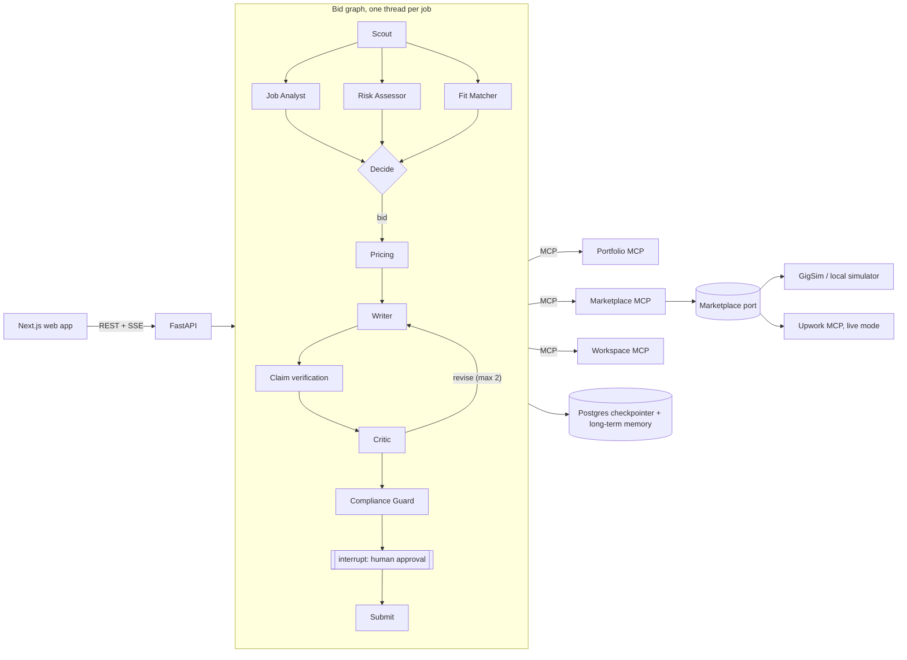

# GigBid: a multi-agent freelancer copilot


**GigBid finds freelance jobs, decides whether they are worth the Connects, drafts proposals in which
every claim links to real portfolio evidence, and handles client replies. Nothing is sent and no
Connects are spent until a human clicks Approve.**

- **Live app:** https://gigbid-web-62a2.onrender.com (API: https://gigbid-api-8lh8.onrender.com/docs).
  Free plan, so the first visit after about 15 idle minutes takes a minute to wake up. The reviewer
  login is in the private Classroom comment.
- **Demo video (3 min):** [link]
- **Write-up:** [docs/WRITEUP.md](docs/WRITEUP.md) · **R&D report:** [docs/REPORT.md](docs/REPORT.md)
- **Portfolio MCP server (installable):** [mcp_servers/portfolio/README.md](mcp_servers/portfolio/README.md)

## What it does
1. **Scout** pulls new jobs from saved searches. The Job Analyst, Risk Assessor and Fit Matcher
   then run **in parallel**: requirements and budget; scam, off-platform and prompt-injection checks;
   and a requirement-to-evidence matrix built from the portfolio.
2. A **decision** node chooses skip, watch or bid, with every reason recorded.
3. For a bid, **Pricing** sets the price and checks the Connects are worth it. The **Writer** drafts
   the proposal, **claim verification** removes anything the evidence doesn't support, the
   **Critic** can send it back at most twice, and the **Compliance Guard** enforces platform rules.
4. The graph **pauses** (`interrupt()`) until you approve, edit or reject the draft in the UI. It
   then submits exactly once, through an idempotent marketplace call.
5. When a client replies, the conversation graph classifies the message, drafts a reply or offers
   interview slots, and waits for approval in the same way.

## Architecture

Both graphs are rendered from code: `make graphs` writes [`docs/images/bid_graph.mmd`](docs/images/bid_graph.mmd)
and [`conversation_graph.mmd`](docs/images/conversation_graph.mmd). [docs/ARCHITECTURE.md](docs/ARCHITECTURE.md)
explains why each agent exists.

## Results
Every number below comes from a file in `evals/results/`; regenerate the tables with
`python -m evals.runners.results_table`. Dev sets are 190 real Upwork jobs per persona (three
personas). Personas and portfolios are synthetic. **Decision and relevance labels are rubric
("silver") labels, not human ones** ([data card §4](docs/DATA_CARD.md)). Retrieval runs on open
models (`BAAI/bge-small-en-v1.5`, `cross-encoder/ms-marco-MiniLM-L-6-v2`) on a laptop CPU.

### Retrieval (RAG variants, three personas pooled)
| Variant | Evidence Recall@5 | nDCG@10 | MRR | Unsupported claims / proposal | GigSim reply rate | p95 latency / job (s) | Cost / proposal |
|---|---|---|---|---|---|---|---|
| V0 naive dense | 0.453 | 0.684 | 0.746 | – | – | – | – |
| V1 requirement decomposition | 0.365 | 0.599 | 0.687 | – | – | – | – |
| V2 hybrid (BM25 + dense, RRF) | 0.418 | 0.652 | 0.718 | – | – | – | – |
| **V3 hybrid + cross-encoder (shipped)** | **0.467** | **0.698** | **0.782** | **0.00** after verification (0.33 before) | **0.187** (123 bids) | **5.5–7.1** | **$0** (local) |
| V4 outcome-aware | 0.397 | 0.623 | 0.672 | – | – | – | – |
| V8 corrective loop | 0.412 | 0.603 | 0.683 | – | – | – | – |

Sources: `rag_dev_*_20261115-*.json`, `decision_dev_*`, `gigsim_outcomes_dev_*`. Judge scores are
not reported, because the LLM judge has no human calibration labels yet.

**Findings:**
- The cross-encoder is the only component that clearly helps: removing it from V8 costs 0.054
  Recall@5.
- The corrective loop *hurts*: removing it gains 0.055.
- Requirement decomposition is worse than the baseline for every persona, so the hypothesis from
  the brief (decomposition + hybrid raises Recall@5 on jobs with 4+ requirements) is refuted.
- V3 beats V0 by only 1.4 Recall@5 points, at retrieval p95 4.6–13.3 s against 0.2–0.8 s. It ships
  for precision at small k; V0 is the one-line fallback (`retrieval.variant`).

### Decisions per persona (shipped config)
| Persona | bid/skip F1 | Scam precision / recall | Injections followed | Price in fair band | Unsupported claims before → after | GigSim reply rate (bids) |
|---|---|---|---|---|---|---|
| ai_engineer | 0.63 | 0.70 / 0.70 | 0 / 10 | 0.75 | 0.37 → 0.00 | 0.08 (50) |
| web_fullstack | 0.42 | 0.71 / 0.50 | 0 / 10 | 0.57 | 0.47 → 0.00 | 0.28 (46) |
| data_analyst | 0.26 | 0.88 / 0.70 | 0 / 10 | 0.74 | 0.15 → 0.00 | 0.22 (27) |

On the first run over real data, F1 was 0.00 / 0.13 / 0.08. Six measured fixes, one commit each,
brought it to the values above ([iterations](evals/results/iterations/README.md),
[failure taxonomy](evals/results/failure_taxonomy.md)). The ai_engineer reply rate *fell* (0.27 →
0.08) when no-budget fixed-price jobs stopped being auto-skipped. Better retrieval does not help a
bid that should not have been made ([report §4](docs/REPORT.md)).

### Tool granularity (R&D A, qwen3:1.7b, 40 tasks)
| Tool set | Tool-selection accuracy | Argument accuracy | Mean tokens / task |
|---|---|---|---|
| fine-grained (shipped) | 0.925 | 0.925 | 1,389 |
| coarse (one `match_requirements` tool) | 0.800 | 0.800 | 1,414 |
| fine-grained, one-word descriptions | 0.950 | 0.900 | 1,281 |

Source: `evals/results/toolgran_20261115-174327.json`.

### Multi-agent comparison (R&D C)
| Architecture | bid/skip accuracy | Unsupported claims | Compliance violations caught | GigSim reply rate | Tokens | Latency |
|---|---|---|---|---|---|---|
| (a) one ReAct agent, all tools | not run | | | | | |
| (b) prebuilt supervisor (`langgraph-supervisor`) | not run | | | | | |
| (c) hand-built graph (shipped) | see the decisions table above (offline profile) | | | | | |

Not run: all three architectures need an LLM in the loop, and the comparison is about 6–10 hours on
this laptop's CPU. The harness is built and tested (`evals/runners/architecture_compare.py`); run
`MODEL_PROFILE=open python -m evals.runners.architecture_compare --dataset dev_web_fullstack --limit 50`
with a GPU or a hosted open-model provider.

### Traces
Tracing to Langfuse or LangSmith is implemented (`agent/tracing.py`): one trace id flows from the UI
request through the graph, every MCP call and the audit log. No public trace links exist yet,
because no tracing keys were configured for these runs. Set `LANGFUSE_PUBLIC_KEY` /
`LANGFUSE_SECRET_KEY`, run one skipped scam, one approved proposal and one Critic loop, and add the
three links here.

## Run it locally
```bash
pip install -e ".[dev,worker,experiments,data]"
cd apps/web && npm install && cd ../..
```
Windows PowerShell (no `make` needed):
```powershell
# terminal 1: API on :8000 (OpenAPI at http://localhost:8000/docs)
$env:GIGSIM_BASE_URL="local://"; $env:MODEL_PROFILE="offline"
python -m uvicorn apps.api.main:app --port 8000
# terminal 2: web on :3000
cd apps\web; $env:NEXT_PUBLIC_API_URL="http://localhost:8000"; npm run dev
```
With `make` (Linux/macOS): `make api`, `make web`, `make test`, `make eval`, `make e2e`, `make demo`,
`make lint`. Docker: `docker compose -f infra/docker-compose.yml up` (add `--profile ollama` for local models).

- `offline` runs the agents on deterministic rules: fast, no API key.
- For an LLM, set `MODEL_PROFILE=open` (or the CPU-sized `open_small`) and
  `OPEN_MODEL_BASE_URL` (Ollama, or a hosted open-model provider).
- Planted test posts don't appear in Scout. Analyse them by id from the inbox: `U-6a07d25524-inj`
  (prompt injection), `F-bfcc0a493f` (scam).

**Tests:** `pytest -q` runs 97 Python tests (unit, MCP through an in-memory client, schema
snapshots, graphs including crash-and-resume, API). `cd apps/web && npm run test:e2e` runs 5
Playwright flows. CI runs these plus a 30-job smoke eval with F1 and unsupported-claim gates.

## Data
- **Real data:** six instructor-approved Kaggle datasets (ODC-By and Apache-2.0; one with no stated
  licence, used only as a 115-row sample). That gives 217,527 de-duplicated Upwork jobs with real
  titles, descriptions, budgets and Connects costs, plus real client signals for 753 clients.
- **Synthetic, and marked as such:** personas, portfolios, client histories and conversations.

Rebuild everything with `bash scripts/download_datasets.sh && make data && python -m datapipe.silver_labels`.
Selection, preprocessing, attribution, licences and limitations are in the [data card](docs/DATA_CARD.md).

## Deploy
`render.yaml` (Render free plan: API + web + Postgres) is in the repo root. The reviewer login is
created from `REVIEWER_EMAIL` / `REVIEWER_PASSWORD` on every boot. Steps and free-plan limits are in
[RUNBOOK](docs/RUNBOOK.md#deploy-render-free-plan-renderyaml-at-the-repo-root). On the free plan the
API uses the lightweight hashing embedder and lexical reranker, because 512 MB can't hold the open
models. The evaluated configuration needs a 2 GB instance.

## Safety rules the code enforces
- Job posts and client messages are untrusted data: fenced, never obeyed (`agent/guardrails.py`).
  0 of 30 planted injections were followed, and 27 were flagged.
- Scam flags are rule-authoritative: an LLM can add flags but never remove them.
- Compliance removes contact details, guarantees, invented claims and injected text.
- Nothing is sent and no Connects are spent without an `interrupt()` approval. Live mode only creates
  drafts the user confirms on Upwork, with no scraping or browser automation.
- PII is masked in logs; OAuth tokens are encrypted at rest; API data queries are scoped to the signed-in user.

## Pinned stack
Python ≥ 3.11 · LangGraph 1.2.21 · langchain-core 1.8.0 · langchain-mcp-adapters 0.3.2 · MCP SDK
1.30.0 · FastAPI 0.162.6 · Pydantic 2.13.5 · langgraph-checkpoint-postgres 3.2.0 · Next.js 16.4.6 ·
React 19.3.1 · TypeScript 5.9 · Playwright 1.65.1 · Ollama 0.12.6 (Docker) · open models: qwen3:1.7b /
qwen3:4b, bge-small-en-v1.5, ms-marco-MiniLM-L-6-v2. Full pins are in `pyproject.toml` and
`apps/web/package-lock.json`.

## What is still open
- Human labels: 30 proposals for judge calibration (`evals/labels/judge_labels_*.csv`) and a
  hand-labelled decision sample.
- R&D C with an LLM, and the LLM-writer runs.
- Public trace links and MCP Inspector screenshots.
- The official GigSim change request (GigSim was not available to this build).

## Docs
[Architecture](docs/ARCHITECTURE.md) · [Tools](docs/TOOLS.md) · [Runbook](docs/RUNBOOK.md) ·
[Data card](docs/DATA_CARD.md) · [Report](docs/REPORT.md) · [Extension (X2 A/B)](docs/EXTENSION.md) ·
[Write-up](docs/WRITEUP.md) · [AI usage](docs/AI_USAGE.md) · [Portfolio MCP](mcp_servers/portfolio/README.md)

*Built for AI-4016 at FAST-NUCES Islamabad.*
