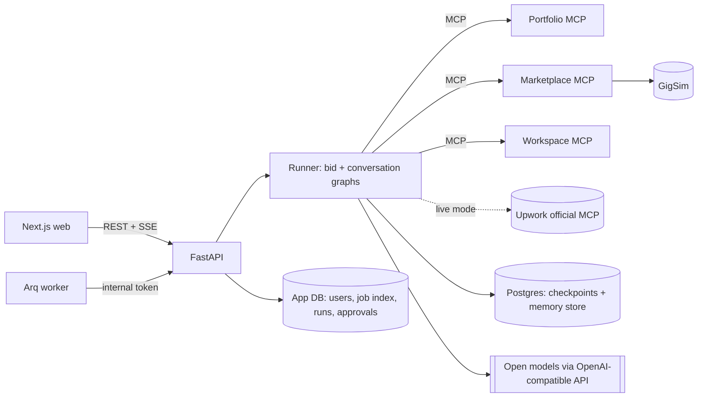
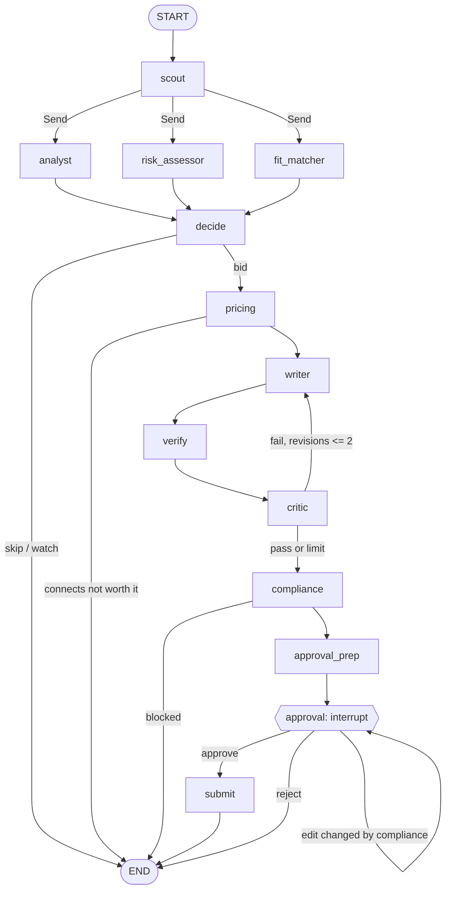

# Architecture

## Deployment view

## Bid graph (one thread per job)

Rendered from code: `python -m dev.render_graphs` writes `docs/images/*.mmd`.
Every edge checks `status`, so `needs_attention` (step/token budget), `dead_letter` (unexpected
error) and `blocked` (Compliance) stop the thread visibly.

## Conversation graph (one thread per client conversation)
`load_thread -> classify_intent -> [propose_slots] -> draft_reply -> reply_approval_prep -> reply_approval (interrupt) -> send_reply`

## Why each agent exists
| Agent | Why it is separate | Model routing |
|---|---|---|
| Scout | Fetch + de-duplicate by content fingerprint (reposts get new ids) | no LLM |
| Job Analyst | Structured JobSpec the UI and Pricing use | small (`qwen3:8b`) |
| Risk Assessor | Rule-authoritative scam flags; an LLM may add flags, never remove them | small |
| Fit Matcher | Requirement-to-evidence matrix via Portfolio MCP; runs in parallel, so it decomposes requirements itself | no LLM |
| Pricing Strategist | Market stats + client budget + user floor; Connects value check; policy hooks | no LLM |
| Proposal Writer | The only creative step; restricted to cited evidence | strongest (`gpt-oss:20b`) |
| Claim verifier | Removes unsupported claims before the Critic sees the draft (R5) | lexical; LLM judge optional |
| Critic | Grounding, personalisation, coverage, length; at most 2 rewrites | strongest |
| Compliance Guard | Policy pack + `extra_rules`; also re-checks user edits | rules (+small LLM optional) |
| Client Liaison | Intent, replies, interview slots | strongest |

Every LLM node has a deterministic implementation used when the `offline` profile is selected or
the model fails (C7 fallback); `MODEL_PROFILE=open` routes nodes to the models in config.

## State, trace, memory (C2)
* **State** (`agent/state.py`): what this job needs now. Reducers on keys parallel branches write
  (`evidence`, `usage`, `trace`, `errors`, `steps`, `status`).
* **Execution trace**: per-node pointers in state; full tool args/results (masked) in the MCP
  audit log, keyed by trace id.
* **Long-term memory** (`agent/memory/`): `style` and `outcome` namespaces in a LangGraph store,
  written only by `promotion_rules.py`. Raw edit and outcome events are logs, not memory.

## Marketplace port (R1)
`agent/marketplace_port.py`: `MarketplacePort` protocol. `gigsim` mode -> `McpMarketplace` (our
Marketplace MCP server -> `GigSimHttp` or `FixtureGigSim`); `upwork_live` mode ->
`UpworkLiveMarketplace` (official Upwork MCP, drafts only). Nodes never import an adapter.

## Stores
| Store | Local | Deployed |
|---|---|---|
| Checkpoints | SQLite (`data/processed/checkpoints.sqlite`) | Postgres (`AsyncPostgresSaver`) |
| Long-term memory | SQLite store | Postgres store |
| Idempotency keys, audit | SQLite + JSONL under `data/processed/` | same, on a volume |
| Portfolio index | in-process numpy + BM25 | swap `PortfolioIndex.dense_search` for pgvector |
